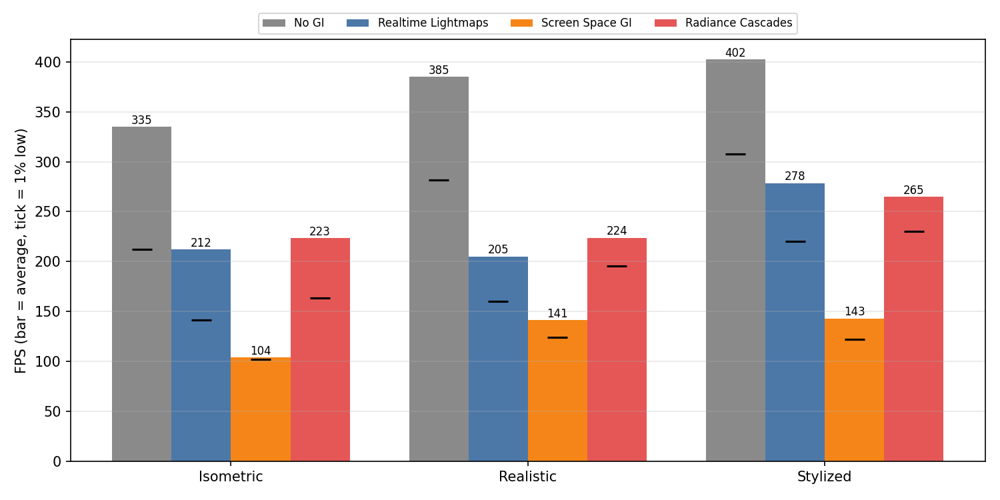
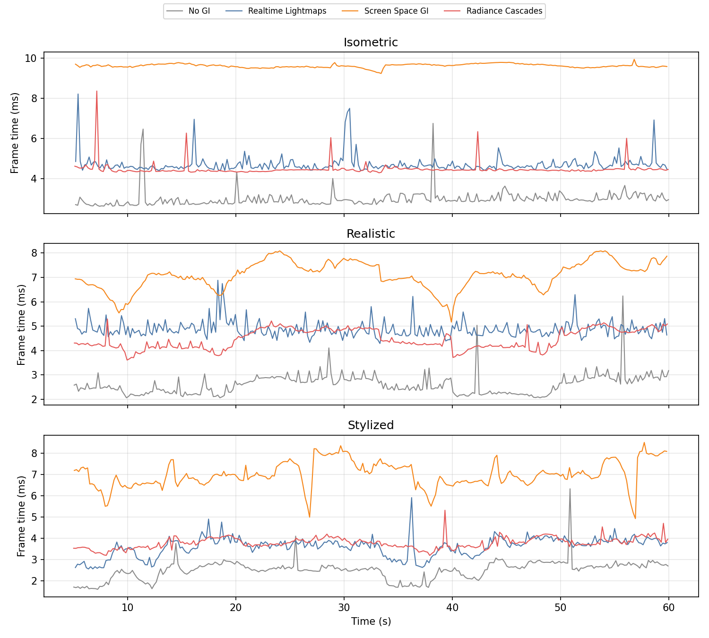
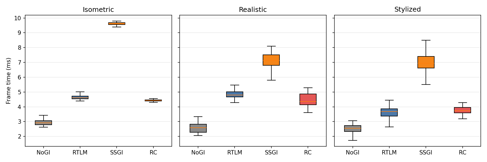

# Radiance Cascades Compared to Unity’s Standard Global Illumination Methods

DIGRA conference experiment setup

This repository contains the experimental materials for the paper:

"Comparative Evaluation of Real-Time Global Illumination Methods in Unity URP"

## Contents

- Raw FPS and frame time datasets

- Generated figures used in the paper

- Render Video recorded for visual comparison can be seen on Youtube Playlist: https://www.youtube.com/watch?v=daDjPJyB86o&list=PLaHv1eGKS6CyZF2IG05RV7KAHvvU5-xIQ

## Results

Frame-time statistics after dropping the first 5 s of each run (scene-loading spikes).
"1% low" is computed from the 99th-percentile frame time.

| Scene | Method | Avg FPS | 1% low FPS | Avg ms | p95 ms | Cost vs No GI |
|---|---|---:|---:|---:|---:|---:|
| Isometric | No GI | 335 | 212 | 2.99 | 3.34 | +0.00 ms |
| Isometric | Realtime Lightmaps | 212 | 142 | 4.72 | 5.14 | +1.73 ms |
| Isometric | Screen Space GI | 104 | 102 | 9.62 | 9.76 | +6.63 ms |
| Isometric | Radiance Cascades | 223 | 164 | 4.48 | 4.60 | +1.49 ms |
| Realistic | No GI | 385 | 282 | 2.60 | 3.18 | +0.00 ms |
| Realistic | Realtime Lightmaps | 205 | 160 | 4.87 | 5.41 | +2.28 ms |
| Realistic | Screen Space GI | 141 | 124 | 7.09 | 7.95 | +4.49 ms |
| Realistic | Radiance Cascades | 224 | 196 | 4.47 | 5.03 | +1.87 ms |
| Stylized | No GI | 402 | 308 | 2.49 | 2.92 | +0.00 ms |
| Stylized | Realtime Lightmaps | 278 | 220 | 3.59 | 4.12 | +1.11 ms |
| Stylized | Screen Space GI | 143 | 122 | 6.99 | 8.01 | +4.51 ms |
| Stylized | Radiance Cascades | 265 | 230 | 3.78 | 4.17 | +1.29 ms |

Radiance Cascades costs roughly as much as Realtime Lightmaps (+1.3 to +1.9 ms over No GI)
with steadier frame times, while SSGI is the most expensive method in every scene (+4.5 to +6.6 ms).







### Reproducing

The raw CSVs use a comma as both the decimal and the field separator
(`12,99,4,373,228,67,RC` = 12.99 s, 4.373 ms, 228.67 FPS), so they do not open
correctly in most tools. `analysis/analyze.py` parses them and regenerates the figures and tables:

```bash
pip install -r analysis/requirements.txt
python analysis/analyze.py
```

## Engine Version

Unity 6000.2.12f1

## Hardware

NVIDIA RTX 4060 Laptop GPU  

Intel Core i7-13620H

## License

MIT

